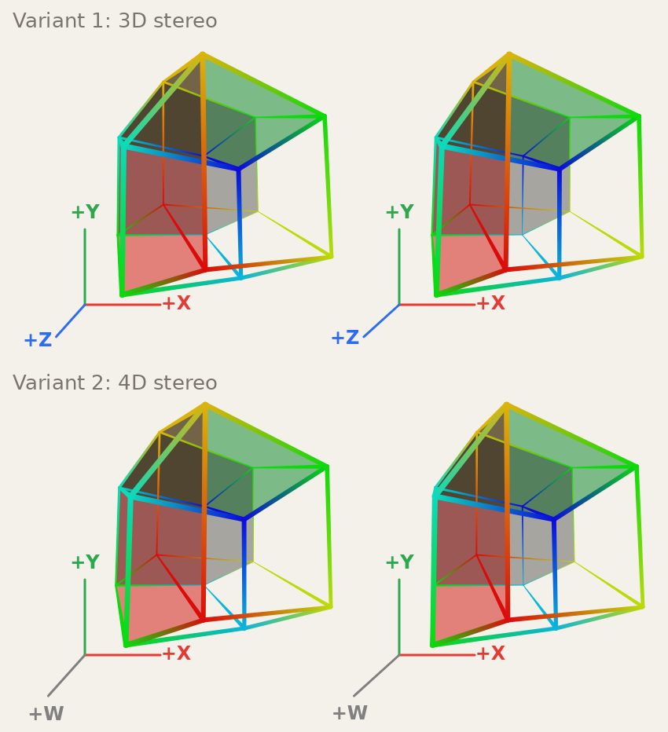
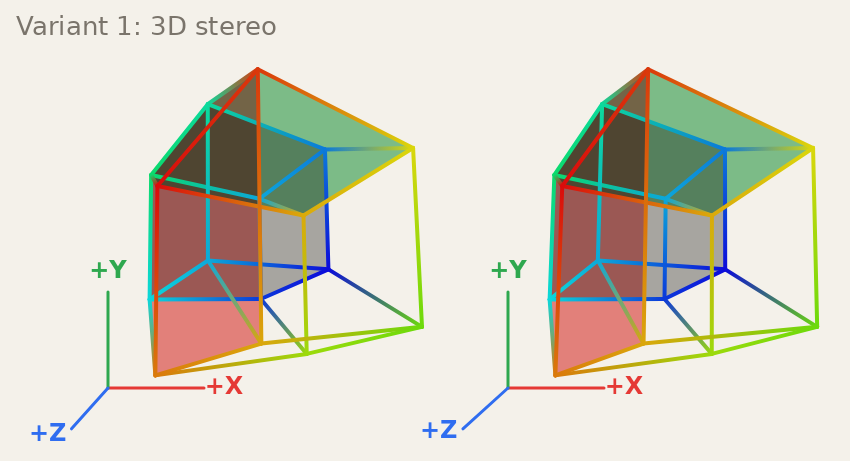
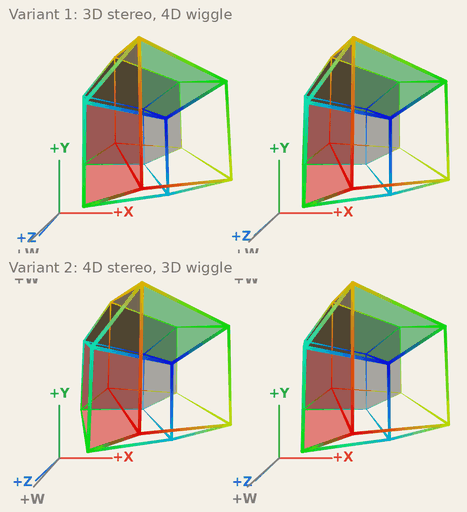
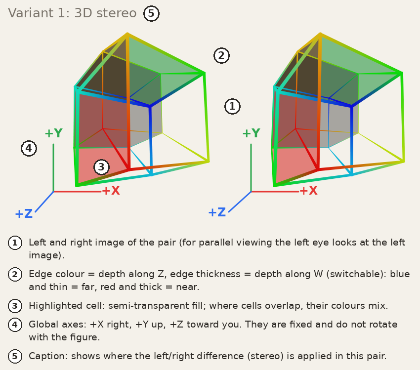
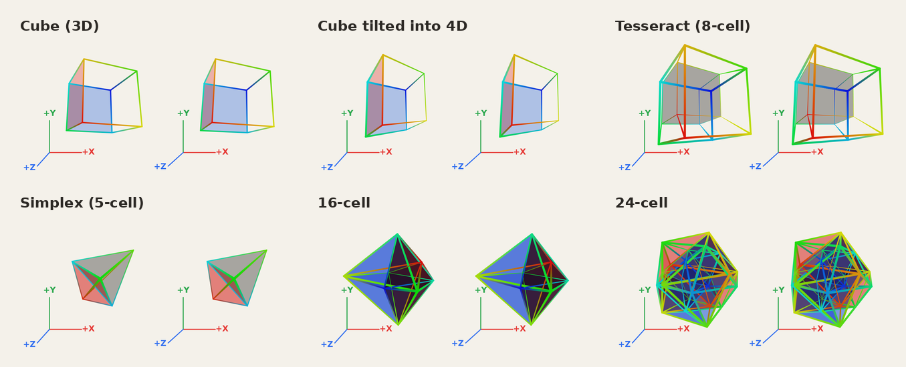

# Stereo 4D polytopes

An interactive, single-file viewer for 4D polytopes (**tesseract**, **5-cell**, **16-cell** and **24-cell**, plus an ordinary **cube** to start with) shown as stereo pairs, so you can *see* their depth with the naked eye, rotate them in all six 4D rotation planes (by hand or automatically), and add a "wiggle" plus edge colour and thickness as further depth cues, so that the two simultaneous depths, **Z** and **W**, can be told apart.

No libraries, no build step, no network access: open `index.html` in a browser, or serve the folder with GitHub Pages.

> Assumed background: you know roughly what a tesseract is and how stereo pairs work. Everything else is explained below.

## Quick start

1. Open [this page](https://well-made.github.io/4d-polytope-viewer/).
2. Drag with the left mouse button to rotate. Drag with the **right** button to rotate "through the fourth dimension".
3. Look at the two images of a pair so that they fuse into one 3D picture (see the next section). Or just switch the wiggle on (*Wiggle* tab) and enjoy the motion parallax - no stereo skill needed. Or let the figure turn by itself (*Auto-rotation* tab).

## How to view the stereo pair

The page shows **two stereo pairs** (top and bottom), each made of a left and a right image.

| Method | What to do | Setting |
|---|---|---|
| **Parallel** (default) | Relax your eyes as if looking *through* the screen at something far away, until the two images drift together and fuse into a third, central one. The left eye must end up seeing the left image. | *Stereo pair → Viewing method → Parallel* |
| **Cross-eyed** | Cross your eyes slightly until the two images overlap. The left eye then sees the right image. | *Cross-eyed* |

Tips: if it is hard to fuse, reduce *Image spacing* (for parallel viewing the centres of the two images should not be farther apart than your eyes, i.e. about 6-7 cm on the screen) or reduce *Stereo strength*.

## What the two pairs are

Both pairs show the same figure, but the two "depth cues" - the left/right difference (**stereo**) and the camera oscillation (**wiggle**) - are applied in different places:

| | Stereo (left/right difference) | Wiggle (camera oscillation) |
|---|---|---|
| **Variant 1** (top) | in the 3D view: you see ordinary 3D depth | in the 4D step: the 4th dimension reveals itself by motion |
| **Variant 2** (bottom) | in the 4D step: depth along **W** appears as stereo depth | in the 3D view: ordinary 3D depth by motion |

The captions above each pair say which is which (the wiggle part is hidden while the wiggle is off, which is the default).

The wiggle in action (one period):

## Controls

### Mouse and touch

| Action | Effect |
|---|---|
| Left drag | Rotate in the **XZ** (horizontal) and **YZ** (vertical) planes - an ordinary 3D rotation |
| Right drag | Rotate in the **XW** (horizontal) and **YW** (vertical) planes - rotation through the 4th dimension |
| Right button + wheel | Rotate in the **ZW** plane (10° per wheel notch) |
| Left + right together, drag left/right | Rotate in the **XY** plane (roll in the screen plane). You can press or release the second button in the middle of a drag |
| Wheel / two-finger pinch | Zoom |
| Touch, one finger | Same as left drag (there is no 4D rotation on touch screens) |

Rotations are applied in the **fixed screen frame** (X right, Y up, Z toward you, W toward the 4D observer), so dragging always feels the same, whatever the current orientation is.

### Panel

Above the tabs:

| Control | What it does |
|---|---|
| **Tesseract / Simplex / Cube / 16-cell / 24-cell** | Switch the figure. Orientation, zoom and sliders are kept; each figure remembers its own highlighted cells. The cube is a plain 3D cube - a familiar starting point for getting used to the rotations and to the depth cues |
| **Reset orientation** | Animated return to the initial orientation: the figure glides back along the shortest rotation path in 0.8 s (zoom and sliders stay). Dragging during the animation cancels it |

The rest of the controls are in five **tabs**; each tab starts with a short description of its controls. The first tab is open at the start.

**Edges & cells**

| Control | What it does |
|---|---|
| **Cue mapping** | Which depth drives which cue: *Colour = Z, thickness = W* (default) or *Colour = W, thickness = Z* |
| **Edge colour: Gradient / Plain** | Colour edges by depth (see below), or draw them in one colour |
| **Edge thickness: By depth / Uniform** | Edge width follows the other depth, or stays at a constant 2 px |
| **Thickness contrast** | How strongly the width depends on depth (default 60 %). At 100 % the width runs from 0.5 px (far) to 10 px (near) |
| **Hide edges the 4D observer cannot see** | Hide the edges (and highlight fills) of cells that face away from the 4D observer (see below). Off by default |
| **Cell toggles** | Highlight cells with a semi-transparent fill. Each button is an independent on/off switch. Tesseract: one row per axis with a **−** and a **+** button (both on = the whole pair of opposite cubes). 5-cell: five buttons, one per cell. Cube: like the tesseract, but the three rows (red, green, blue, side by side) highlight its square faces. 16-cell: like the tesseract (a row per axis with **−** and **+**), but each button lights the 8 cells that meet at that vertex. 24-cell: four buttons, one per ring of six octahedra |
| **Fill opacity** | Opacity of the highlighted cells |

**Auto-rotation**

| Control | What it does |
|---|---|
| **Plane grid** (XY XZ YZ / ZW YW XW) | Click a plane to cycle *off → + → −* (the two directions). Each column is a pair of completely orthogonal planes (XY/ZW, XZ/YW, YZ/XW): switch on both planes of a column for a genuine **double rotation**, or combine several columns. The rotation is in the fixed screen frame, so the plane names match the axes drawn in the corner. Dragging with the mouse still works on top |
| **Auto-rotation running** | Pause and resume without losing the selection |
| **Speed** | 2-180 degrees per second (default 45) |

**Wiggle**

| Control | What it does |
|---|---|
| **Wiggle** (checkbox) | Switch the camera oscillation on/off (off at the start) |
| **Wiggle direction** | Oscillate vertically or horizontally, or move the camera around a circle, clockwise (↻) or counter-clockwise (↺) |
| **Amplitude / Frequency** | Size of the oscillation (radius, for the circle) and its speed (Hz) |

**Perspective**

| Control | What it does |
|---|---|
| **3D field of view** | Perspective strength of the 3D → 2D step. A larger angle means stronger perspective |
| **4D field of view (along W)** | Perspective strength of the 4D → 3D step |

**Stereo pair**

| Control | What it does |
|---|---|
| **Viewing method** | Parallel or cross-eyed (swaps the left and right camera) |
| **Image spacing** | Horizontal distance between the left and right image of a pair |
| **Pair spacing** | Vertical distance between the top and the bottom pair |
| **Stereo strength** | How far apart the two virtual eyes are (bigger = stronger depth effect) |

## Visual cues

* **Edge colour and thickness** - one cue for each of the two extra depths. A 4D figure has *two* depths at once: **Z** (toward you in the 3D picture) and **W** (toward the 4D observer). Stereo and wiggle each show depth, and the brain tends to merge the two into a single depth. Giving each depth its own label helps to keep them apart. By default (*Cue mapping*): **colour = Z**, **thickness = W**; the switch swaps them.
  * **Colour** (*Gradient* mode): **blue** = far, **red** = near. An edge fades from the colour of one end to the colour of the other.
  * **Thickness**: thin = far, thick = near, tapering smoothly along each edge (0.5 to 10 px, set by *Thickness contrast*).
  * Both cues use the figure's *own* rotated coordinates, not the stereo or wiggle shifts, so they are identical in the left and right image of a pair and never disturb the fusion. In the start orientation of the tesseract Z and W take the same values, so both cues look alike there; they separate as soon as you rotate.
  * The interesting case is a point that is *far* in Z but *near* in W (with the default mapping: blue, yet thick; in variant 1 the stereo also shows it far): the two depths now disagree, and with a little practice you can see them as two separate things instead of one merged depth. The cube is the easiest figure to start with; the tesseract has many edges and takes longer.
* **Hidden edges** (checkbox *Hide edges the 4D observer cannot see*): a 4D observer sees only the outer boundary of the figure, like a 3D observer who sees the front faces of a solid but not the back ones. Cells that face away are hidden, together with the edges that belong only to them. In the start orientation of the tesseract you see just the near cube (12 of the 32 edges); rotate and the side cells come into view. Each image of a pair has its own viewpoint, so in variant 2 the left and the right eye see slightly different cells. The flat cube has nothing to hide.
* **Coloured axes in the lower-left corner of each image**: the *fixed* global axes of the screen frame. They do **not** rotate with the figure - they show the directions you are rotating relative to.
  * **+X** (red) right, **+Y** (green) up, **+Z** (blue) toward you, **+W** (gray) toward the 4D observer.
  * Z and W both point "into the screen", so they look nearly collinear; their labels are shifted apart. They are projected like the figure, so the field-of-view sliders change their length.
  * In variant 1 the **W** axis moves with the wiggle while **Z** only shows the stereo shift; in variant 2 it is the other way round (**Z** wiggles, **W** shows the stereo shift). X, Y and the origin never move. While the wiggle is off, the axis that exists to show it (W in variant 1, Z in variant 2) is not drawn.
* **Highlighted cells**: filled with a semi-transparent colour.
  * Tesseract: a cell takes the colour of its axis - X red, Y green, Z blue, W gray; "−" and "+" mean the cell at the negative or positive end of that axis. By default the W− cell (the inner cube at the start orientation) is on.
  * Cube: its six faces are highlighted instead (it has no cells of its own); a face takes the colour of its axis, as for the tesseract.
  * 16-cell: a button lights the *star* of one vertex - all 8 tetrahedral cells that meet there - in the colour of that vertex's axis. A cell has four vertices (one on each axis), so where stars overlap their colours mix.
  * 24-cell: its 24 octahedral cells fall into 4 rings of 6; each ring is a closed chain of cells joined face to face. The four buttons (red, green, blue, gray) light one ring each.
  * 5-cell: cells are numbered 1-5 (colours red, green, blue, gray, orange). **Cell k is made of all vertices except vertex k.** Vertex 5 is the apex, pointing along +W at the start orientation; cell 5 is therefore the opposite "base" tetrahedron.
* **Overlapping highlights mix.** Where highlighted cells overlap, their colours blend (like overlapping coloured filters on a light theme, like overlapping lights on a dark theme), and the result does not depend on which cell is drawn first - so no colour can hide another one.
* **Captions** above the pairs: which variant it is, and (while the wiggle is on) which space wiggles.

## The figures

| | Vertices | Edges | Faces | Cells | Note |
|---|---|---|---|---|---|
| Cube (3D) | 8 | 12 | 6 squares | 1 cube | an ordinary cube lying in the hyperplane w = 0: XY, XZ and YZ rotations are plain 3D rotations, anything involving W tilts it into 4D |
| Tesseract (8-cell) | 16 | 32 | 24 squares | 8 cubes | vertices at (±100, ±100, ±100, ±100) |
| Simplex (5-cell) | 5 | 10 | 10 triangles | 5 tetrahedra | 4 vertices form a regular tetrahedron, the 5th is the apex on +W; all edges are equal; 3 cells meet at each edge |
| 16-cell (cross-polytope) | 8 | 24 | 32 triangles | 16 tetrahedra | vertices (±180, 0, 0, 0) and permutations; **4** cells meet at each edge |
| 24-cell | 24 | 96 | 96 triangles | 24 octahedra | vertices are the permutations of (±1, ±1, 0, 0), scaled; every edge equals the circumradius; 3 cells meet at each edge |

## How it works (short version)

1. **Orientation.** The figure's orientation is a 4×4 rotation matrix. Dragging multiplies it by a small rotation in one of the six coordinate planes (XY, XZ, XW, YZ, YW, ZW); the matrix is re-orthonormalised each time so rounding errors never accumulate.
2. **Projection.** A 4D point goes through two perspective steps: **4D → 3D** (a camera on the W axis; points with larger W look larger and move outward) and then **3D → 2D** (a camera on the Z axis, the usual perspective). The two *field of view* sliders set the strength of each step.
3. **Stereo.** Each image of a pair is rendered by a camera shifted sideways by ± *Stereo strength*. Shifting the camera moves a point sideways by an amount that depends on its depth, which creates the left/right difference your brain turns into depth. In *variant 1* the shift is applied in the 3D → 2D step, in *variant 2* in the 4D → 3D step.
4. **Wiggle.** The same camera offset, but equal for both eyes and oscillating in time (along a line or around a circle). Depth is then perceived from motion parallax. It is applied to the step that does *not* carry the stereo shift.
5. **Cell highlight.** A shape stores its highlightable parts (a cell, a face, or several cells together) as lists of faces; highlighted faces are filled before the edges are drawn. Overlapping fills are blended with an order-independent mode (`multiply` on a light theme, `screen` on a dark one), which is why the canvas is first filled with an opaque background colour.
6. **Global axes.** A small frame in the same 4D space, not affected by the rotation, positioned in the plane `z = 0, w = 0` so that each axis reacts only to the camera shift that belongs to it.
7. **Depth cues.** After the rotation every vertex has a Z and a W value; one drives the colour, the other the width. An edge is drawn as a quad whose width runs linearly from one end to the other, with a round cap at each end, filled with a linear gradient between the two end colours.
8. **Hidden edges.** The cells (facets) of a convex polytope are found automatically from the vertices: take any 4 vertices, form the hyperplane through them, and keep it if all other vertices lie on one side. A cell faces a 4D camera at `C` when `n · C > h` (outward normal `n`, distance `h` from the origin). An edge or face is visible when at least one cell containing it faces the camera. This is computed separately for each image, because stereo and wiggle move the camera.
9. **Auto-rotation.** Each frame the orientation is multiplied by a small rotation in every selected plane, by *speed × elapsed time*, in the fixed screen frame (exactly like dragging).
10. **Animated reset.** The orientation `R` is written as `exp(L)`, where `L = log R` is found by repeated matrix square roots and a short series; the figure then follows `exp((1 − s)·L)` while `s` goes from 0 to 1 with ease-in/ease-out. Every intermediate matrix is a true rotation (no shrinking or shearing), and the path is the shortest one.

## Code map and adding a figure

Everything is in `index.html` (the code is commented for both people and AI assistants; sections are numbered `SECTION 1…10`):

| Section | Content |
|---|---|
| 1-2 | DOM references, colours |
| 3 | **Shapes** - plain data objects (vertices, edges, highlight groups as lists of faces), plus the generic cell finder used for hidden edges |
| 4-5 | State, 4D rotation maths, including the matrix logarithm / exponential of the animated reset |
| 6 | Rendering: projection, depth cues (colour, thickness), hidden edges, cell fill, edges, global axes, captions |
| 7 | Mouse and touch input |
| 8 | Animation loop (wiggle, auto-rotation, reset), tabs and button groups |
| 9 | Cell highlight panel |
| 10 | Figure switch, reset, start-up |

The `images/` folder holds the pictures used in this README and the social preview image (`og-image.png`, referenced from the page's `<head>`).

To add another polytope (for example a truncated tesseract), write one `makeXxx()` function in SECTION 3 that returns `{ id, V, E, groups, on, panel }` (see the comment there; `panel` describes the highlight buttons), register it in `SHAPES`, and add a button with `data-v="<id>"` inside `#segShape`. The renderer and the panel builder do not need to change. For polytopes with hundreds of edges you may want to cache the per-edge gradients, since a frame draws every edge four times.

## Limitations

* No 4D rotation on touch screens (one finger acts like the left mouse button).
* Rendering uses the 2D canvas and draws each edge with its own gradient, which is comfortable for small figures but not meant for polytopes with hundreds of edges.

## Feedback

Questions, ideas and opinions are welcome in [Discussions](https://github.com/well-made/4d-polytope-viewer/discussions). Bug reports go to [Issues](https://github.com/well-made/4d-polytope-viewer/issues).
